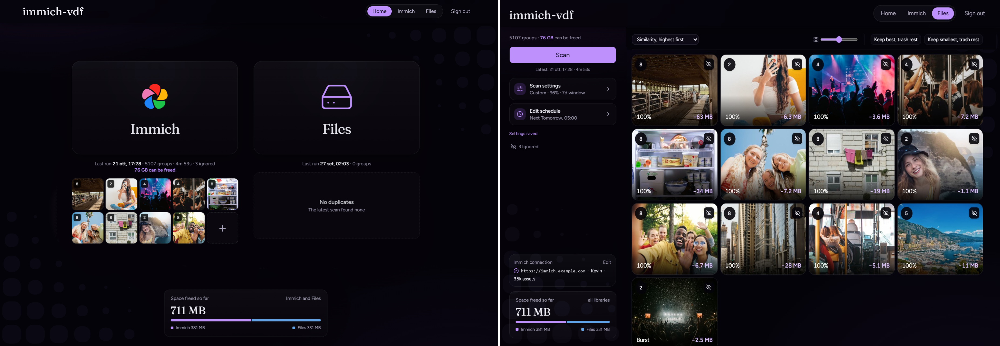

# immich-vdf

Find **duplicate photos and videos** in your **[Immich](https://immich.app) library**, compare them side by side, and clear the ones you don't want. It also works with **external libraries**.

Built on [Video Duplicate Finder](https://github.com/0x90d/videoduplicatefinder). [AGPL-3.0](LICENSE).

> DISCLAIMER: This whole app is vibe coded. Run it on your own network or behind a reverse proxy, and don't expose it directly to the internet.

## Run

1. Install Docker.
2. In an empty folder, save [docker-compose.example.yml](docker-compose.example.yml) as `docker-compose.yml`.
3. Save [.env.example](.env.example) as `.env` and set `APP_PASSWORD`, `MEDIA_PATH` and `IMMICH_PATH`.
4. Run `docker compose up -d`.
5. Open `http://<host>:4747` and sign in.

More setup options are in [Installation](https://vinrosso.github.io/immich-vdf/install).

## Documentation

- [Installation](https://vinrosso.github.io/immich-vdf/install)
- [Usage](https://vinrosso.github.io/immich-vdf/usage)
- [Development](https://vinrosso.github.io/immich-vdf/development)
