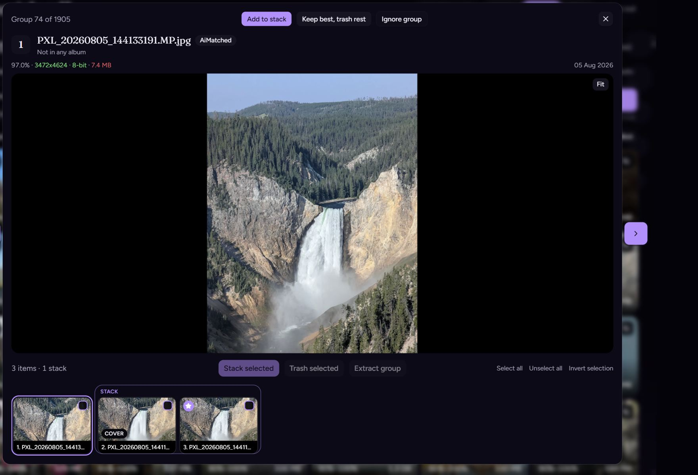

# Review

## On this page

- [Keys](#keys)
- [After an action](#after-an-action)

Open a group from the results. [Photos](photos) covers zoom and difference. [Groups](groups) covers merging and extracting.

## Keys

| Key | Action |
| --- | --- |
| `Left` | Previous group |
| `Right` | Next group |

These don't work while you're typing in a field. When the video slider is focused, `Left` and `Right` move through the clip instead. More keys are on [Shortcuts](shortcuts).

## After an action

| What you did | What you see next |
| --- | --- |
| Stacked, trashed or ignored, and the group still has files | The same group |
| The group is gone | The next group |
| Closed the group | The results. Nothing changes. |

Videos play in your browser. If the browser can't play a file directly, it's converted as it plays. Videos in a group play side by side and stay in sync. Photos show one at a time.
