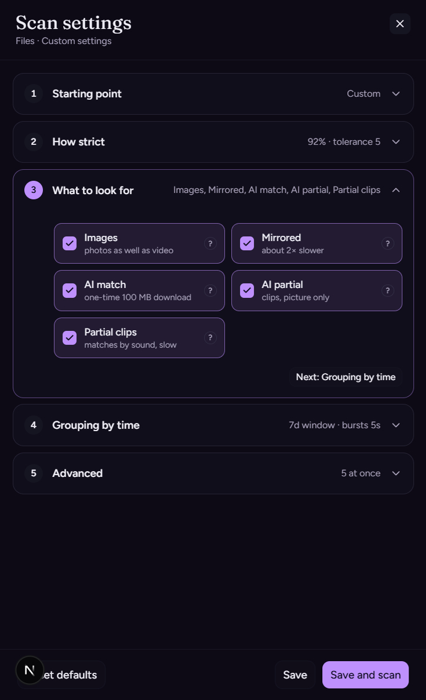

# Scan

## On this page

- [Pick a starting point](#pick-a-starting-point)
- [Settings worth leaving alone](#settings-worth-leaving-alone)

Open **Immich** or **Files**, choose your settings under **Scan settings**, and select **Scan**. Only one scan runs at a time, across both pages.

Repeat scans are much faster. If no files and no settings have changed, the scan finishes right away and keeps your last results. When only some files changed, only those are checked again. The first scan after an update can take longer.

## Pick a starting point

Under **Scan settings**, the first step sets a starting point. You can fine-tune everything after that.

| Starting point | Use it when | Cost |
| --- | --- | --- |
| **Recommended** | You're not sure. A good default for most libraries. | Balanced |
| **Exact & near** | You want copies, renames and re-encodes. Similarity 98%. | Fastest |
| **Edited & altered** | You also want crops, watermarks, flips and quality changes. Similarity 92%, Mirrored on. | Good first pass |
| **AI scan** | Crops and re-edits are still being missed, or you want clips cut from longer videos. | Downloads about 100 MB the first time |
| **Deep clean** | You also want clips matched by sound. | Slowest |

> Start with **Recommended**. Move to **Edited & altered** or **AI scan** if edits are still missing. Use **Deep clean** only if you need clips inside longer videos.

## Settings worth leaving alone

| Setting | Suggestion |
| --- | --- |
| Hash tolerance | Leave at 5. Lower is stricter and can miss real duplicates. |
| Similarity | Let the starting point set it. A much lower value fills your results with weak matches. |
| Time window | Immich starts at 7 days, so photos from the same event are compared. Files starts at 0, which compares your whole library. Raise it only if the same photo was imported months apart. Dates come from Immich first, including dates you edited there, then from the file itself. |
| Bursts | Also groups photos taken within this many seconds of each other that share a file-name prefix, even if they don't look alike. Starts at 5. Set 0 to turn it off. |
| Parallel jobs | Use the suggested number. |
| Images | Leave on unless you only care about video. |
| pHash | Leave off unless you know you want it. |

**Reset defaults** restores the built-in settings. Pick a starting point again afterwards.

On the Files page, add at least one folder. Exclude any folder you never want compared.

A schedule has its own settings, separate from the ones on the page. See [Schedule and webhook](schedule).
