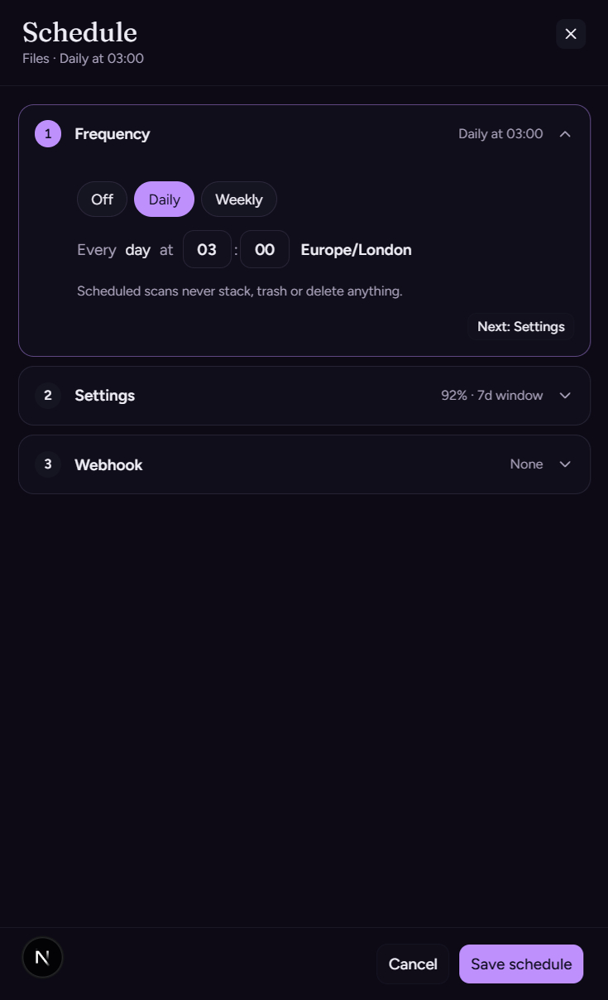

# Schedule and webhook

## On this page

- [Missed runs](#missed-runs)
- [Webhook](#webhook)

**Add schedule** sets up a daily or weekly scan for that page. A schedule has its own matching settings, separate from the ones on the page.

Scheduled scans never stack, trash or delete anything. They only find duplicates for you to review.



Times use the time zone you pick, not the server's. To stop the scans, delete the schedule. That also removes the webhook. Your scan settings stay as they are.

## Missed runs

If another scan is running at the scheduled time, the scheduled scan starts when that one finishes. If the server is down, it runs after the server restarts, up to a day late.

A scan is tried at most three times. If it still hasn't run after three tries or a day of waiting, it's skipped and shown as **Skipped** on the page. A scan stopped by a normal shutdown is marked as interrupted and doesn't count as a try.

## Webhook

The webhook is a single URL for the whole app. It's called when a **scheduled** scan finishes, and also when one is skipped. Scans you start yourself don't call it.

**Send test** posts a sample message and waits up to 10 seconds for a reply. The URL must start with `http` or `https`. Loopback, link-local and cloud-metadata addresses are refused, but LAN addresses work.

```json
{
  "section": "immich",
  "status": "ok",
  "groupCount": 12
}
```

| Field | Values |
| --- | --- |
| `section` | `immich` for the Immich page, `server` for the Files page |
| `status` | `ok`, `error` or `skipped` |
| `groupCount` | Duplicate groups after the scan. `0` for a test or a skipped run. |

If the webhook replies with an error (status 300 or higher), your scan results are still saved. The failure is only noted in the scan log.
