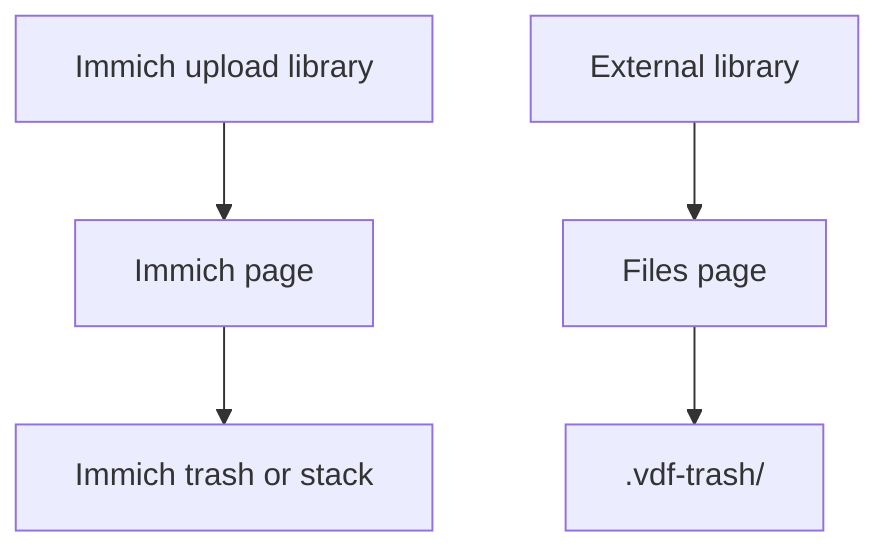

# Usage

## On this page

- [Pages](#pages)

Sign in with your `APP_PASSWORD`. Home has a card for each page. The card shows when the last scan finished, how many groups it found, how long it took, and how much space you can free. Below the cards, **Space freed so far** adds up the space that trashed duplicates has freed, split between Immich and Files.

The two pages are independent, each with its own results.

| Page | Use it for | Removing a duplicate |
| --- | --- | --- |
| **Immich** | Immich's upload library | Stack it or move it to Immich's trash |
| **Files** | An external library Immich reads | Move it to a `.vdf-trash/` folder, which you can restore from |

> Don't scan the same files on both pages.

After you trash a file on the Files page, Immich keeps showing it until it rescans that library.

## Pages

1. [Two libraries](libraries)
2. [Immich](immich)
3. [Files](files)
4. [Scan](scan), then [Schedule and webhook](schedule)
5. [Review](review), then [Photos](photos) and [Groups](groups)
6. [Shortcuts](shortcuts)
